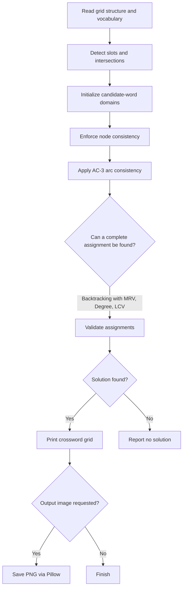

# Crossword Solver — Constraint Satisfaction & Search

**Harvard CS50's Introduction to Artificial Intelligence with Python · Project 3: Optimization**

An AI-powered crossword generator that models word placement as a **constraint satisfaction problem (CSP)**. Given a grid pattern and a vocabulary, it finds a complete assignment of words while respecting word lengths, crossing letters, and uniqueness constraints.

> **Academic context:** This is a CS50AI educational project. The documentation explains the algorithms, inputs, and observed results. Course materials and starter components are credited to Harvard CS50. See [Academic Attribution](#academic-attribution).

## Project overview

A crossword consists of open cells, blocked cells, and horizontal or vertical **word slots**. Each slot is a variable whose domain initially contains the available vocabulary. A solution must assign one word to every slot such that:

1. The word length matches its slot.
2. Crossing words agree on their shared letters.
3. No word is reused in another slot.

The solver combines **constraint propagation** with **heuristic-guided recursive backtracking** to reduce the search space before and during assignment.

## Example output

A generated PNG preview can be displayed here once `output.png` is uploaded to the repository root alongside this README. To enable the image preview, uncomment the Markdown line below:

```markdown

```

You can also reproduce solutions directly in the terminal. For easier reading on GitHub, the filled blocks (`█`) printed by the program are shown as `#` in this ASCII transcription:

```text
$ python generate.py data/structure0.txt data/words0.txt
#SIX#
#E##F
#V##I
#E##V
#NINE
```

The filled grid above was verified against the files included in this project. The exact word arrangement can vary in cases where more than one assignment satisfies the constraints.

## Core AI techniques

### Constraint satisfaction model

| CSP component | Crossword interpretation |
| --- | --- |
| Variables | Horizontal and vertical word slots of length greater than one |
| Domains | Candidate words from the selected vocabulary |
| Unary constraints | Word length must equal the slot length |
| Binary constraints | Letters must agree where two slots intersect |
| Global requirement | Assigned words must be distinct |

`crossword.py` constructs a grid representation, detects slots, records their cells, and computes pairwise intersections. `generate.py` owns the solver and output routines.

### 1. Node consistency

The solver begins by removing words that do not match each variable's required length. This ensures every remaining domain value meets its unary constraint.

### 2. Arc consistency (AC-3)

For each directed arc between overlapping word slots, the `revise` operation removes candidates that have no compatible word in the neighboring slot. The **AC-3** queue revisits affected neighbors until no further domain reductions are required or a domain becomes empty.

### 3. Backtracking search

After propagation, recursive backtracking assigns candidate words to unfilled slots. Each tentative assignment is checked for consistent lengths, distinct words, and matching intersection letters. If a branch becomes inconsistent, the solver undoes the assignment and tries another candidate.

### 4. Search-ordering heuristics

- **Minimum Remaining Values (MRV):** Choose the unassigned slot with the fewest candidate words.
- **Degree heuristic:** Break MRV ties in favor of the slot connected to the most other slots.
- **Least Constraining Value (LCV):** Try words that eliminate the fewest available values for unassigned neighboring slots.

These heuristics guide the search toward constrained decisions while preserving possible options for the remaining variables.

## System architecture



The program's `solve()` method invokes node consistency, AC-3, and then backtracking. Image export is optional.

## Repository structure

```text
crossword/
├── crossword.py              # Grid, variables, cells, intersections, neighbors
├── generate.py               # CSP solver, terminal display, optional PNG export
├── output.png                # Example generated crossword image
├── assets/
│   └── fonts/
│       └── OpenSans-Regular.ttf
└── data/
    ├── structure0.txt        # Crossword layouts: _ = open cell
    ├── structure1.txt
    ├── structure2.txt
    ├── words0.txt            # Candidate word lists
    ├── words1.txt
    └── words2.txt
```

Python `__pycache__/` files may also be present locally; they are automatically generated bytecode caches and are not required for execution.

## Requirements

- **Python 3.12** (recommended for CS50AI coursework; the core solver also uses standard Python features)
- **Pillow** (`PIL`) only when saving PNG images

Install Pillow if needed:

```powershell
python -m pip install Pillow
```

No extra third-party package is needed to print crossword results to the terminal.

## Run the project

Run these commands from the folder containing `generate.py`.

**Windows PowerShell:**

```powershell
cd "X:\IO++\GitHub Upload\crossword"
python generate.py data/structure0.txt data/words0.txt
python generate.py data/structure1.txt data/words1.txt
python generate.py data/structure2.txt data/words2.txt
```

**macOS / Linux:**

```bash
python3 generate.py data/structure0.txt data/words0.txt
```

**Export a PNG image:**

```powershell
python generate.py data/structure0.txt data/words0.txt solved_crossword.png
```

The optional final argument specifies the output image filename. The script prints `No solution.` when it cannot find a consistent complete assignment.

## Verified behavior

The following tests were run using the files provided in the project archive:

| Test case | Command input | Observation |
| --- | --- | --- |
| Small example | `data/structure0.txt` + `data/words0.txt` | Solved and printed a 5 × 5 grid |
| Medium example | `data/structure1.txt` + `data/words1.txt` | Solved and printed a 9 × 14 grid |
| Additional example | `data/structure2.txt` + `data/words2.txt` | Solved and printed a 6 × 7 grid |
| Image export | `structure0.txt` + `words0.txt` + output filename | Saved a valid 500 × 500 PNG |

For example, the medium-sized crossword contains the words **INTELLIGENCE**, **LOGIC**, and **SEARCH** in its generated solution. These observations verify successful execution on the bundled examples; they are **not** performance benchmarks or claims of optimal runtime.

## Implementation notes

The project separates **problem modeling** from **search**:

- `Variable` stores slot position, orientation, length, and occupied cells.
- `Crossword` loads grid and word-list files, identifies variables, and calculates overlapping positions.
- `CrosswordCreator` handles domain filtering, AC-3, assignment consistency, ordering heuristics, recursive backtracking, textual rendering, and PNG image creation.

The solver does **not** use machine learning or train a neural network. It is an example of **symbolic AI**, where explicitly modeled constraints and search algorithms produce a solution.

## Skills demonstrated

**Artificial Intelligence · Constraint Satisfaction Problems (CSP) · Arc Consistency (AC-3) · Backtracking Search · MRV · Degree Heuristic · Least Constraining Value · Graph-Based Constraints · Python · Algorithm Design · Problem Solving**

## Academic attribution

- **Course:** [CS50's Introduction to Artificial Intelligence with Python](https://cs50.harvard.edu/ai/)
- **Institution:** Harvard University / CS50
- **Original assignment:** [Crossword — CS50AI](https://cs50.harvard.edu/ai/projects/3/crossword/)
- **Certificate:** [Verified CS50AI certificate](https://cs50.harvard.edu/certificates/4d1848b5-b7cc-4b37-8155-819e19e6054d)

This repository documentation describes an educational assignment completed as part of CS50AI. The course authors retain attribution for the original assignment and distributed starter materials. **Public availability of source solutions remains subject to CS50's academic honesty rules**; this README alone is suitable for a public-facing project overview.
